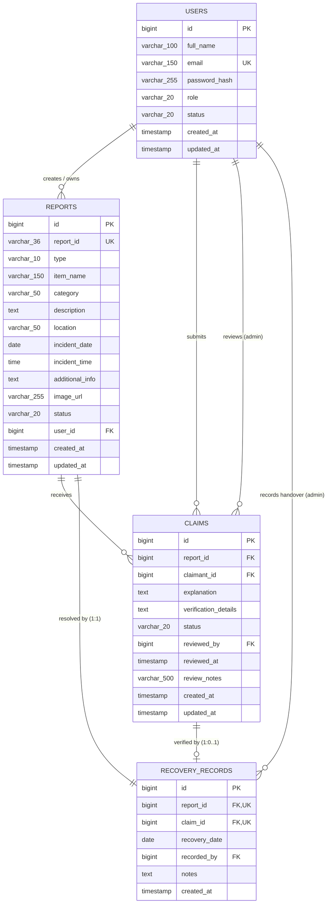
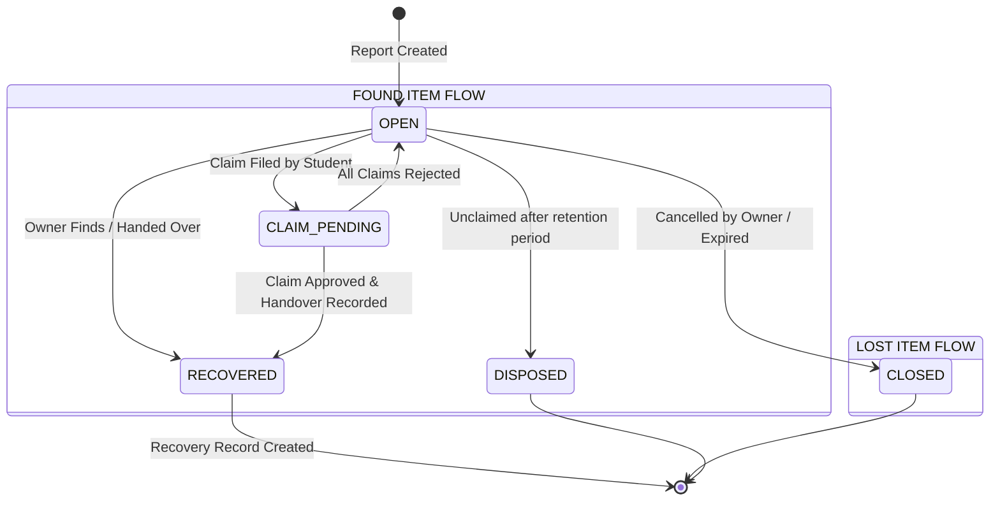
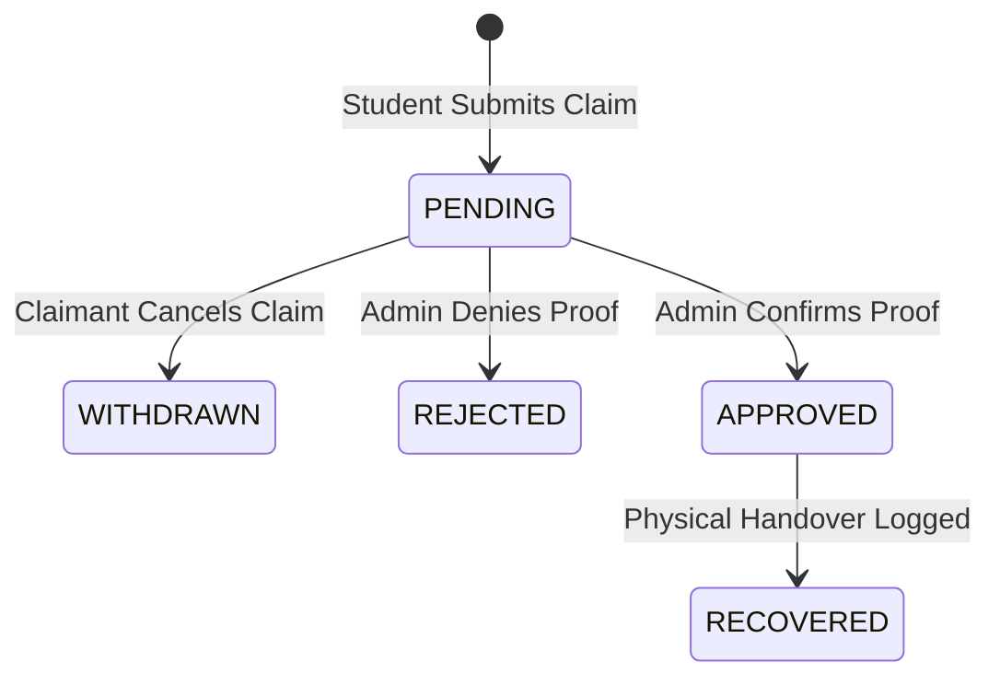

# CampusFind — Database Design Specification (Phase 3)

**Document Version:** 1.1.0 (Post-Review Corrections Applied)  
**Target RDBMS:** MySQL 8.0+  
**Target Backend Framework:** Java 17+ / Spring Boot 3.x (Spring Data JPA / Hibernate 6.x)  
**Database Name:** `campusfind`  
**Status:** PROPOSED (Awaiting User Final Approval — Non-Executed)

---

## 1. Purpose and Scope

### 1.1 Purpose
This document establishes the official relational database architecture for the **CampusFind** college platform. The objective of Phase 3 is to design a robust, normalized (3NF), and scalable schema that replaces client-side `localStorage` persistence and bridges the existing HTML/CSS/JavaScript frontend to the future Spring Boot backend.

### 1.2 Scope
The scope of this design encompasses:
- Complete relational data models for **reports**, **users**, **claims**, and **recovery records**.
- Precise mapping between existing frontend form inputs, select options, and SQL column types.
- Relational integrity rules (primary keys, foreign keys, uniqueness, and cascading behavior).
- Indexing strategies optimized for search and filtering workloads.
- Service-layer recovery transaction specifications and atomic concurrency controls.
- Safe audit retention policies preventing accidental claim history deletion.
- Comprehensive Java / MySQL 8.0 type compatibility verification.
- Spring Data JPA entity mapping guidelines for Phase 4.

---

## 2. Entity-Relationship (ER) Architecture

### 2.1 Mermaid ER Diagram



### 2.2 Cardinality & Relationship Breakdown

| Relationship | Cardinality | Business Logic & Justification |
|---|---|---|
| `users` → `reports` | 1 : N (One-to-Many) | A user (student/staff) may report multiple lost or found items. Each report belongs to one registered user (nullable initially for guest reporting migration). |
| `reports` → `claims` | 1 : N (One-to-Many) | A found item report can receive multiple competing ownership claims from different students. |
| `users` → `claims` (claimant) | 1 : N (One-to-Many) | A student can file claims across different found items. |
| `users` → `claims` (reviewer) | 1 : N (One-to-Many) | An administrator reviews and adjudicates multiple claims. |
| `reports` → `recovery_records` | 1 : 1 (One-to-One) | **Strictly One-to-One.** Once an item is recovered and handed over, exactly one recovery record is generated. A database unique constraint on `report_id` guarantees an item cannot be handed over multiple times. |
| `claims` → `recovery_records` | 1 : 0..1 (Zero-or-One) | When an item is recovered via an approved claim, the recovery record references that claim. A database unique constraint on `claim_id` ensures a single claim cannot be used for multiple recoveries. Direct owner recoveries (e.g., lost item found directly) leave `claim_id` as `NULL`. |
| `users` → `recovery_records` | 1 : N (One-to-Many) | An authorized staff member or administrator logs multiple recovery events. |

---

## 3. Table Definitions & Schema Specification

All tables use the MySQL `InnoDB` storage engine with `utf8mb4` character set and `utf8mb4_unicode_ci` collation. Identifiers use standard signed `BIGINT` to map cleanly to Java `java.lang.Long`.

### 3.1 Table: `users`
Represents student, faculty, and administrator accounts.

| Column | MySQL Data Type | Constraints & Defaults | Description |
|---|---|---|---|
| `id` | `BIGINT` | `AUTO_INCREMENT`, `PRIMARY KEY` | Internal surrogate primary key (maps to Java `Long`). |
| `full_name` | `VARCHAR(100)` | `NOT NULL` | User's legal or campus name. |
| `email` | `VARCHAR(150)` | `NOT NULL`, `UNIQUE` | Unique institutional email address (e.g., `@campus.edu`). |
| `password_hash` | `VARCHAR(255)` | `NOT NULL` | Salted password hash (BCrypt / Argon2id). Never plaintext. |
| `role` | `VARCHAR(20)` | `NOT NULL`, `DEFAULT 'STUDENT'` | Access level: `STUDENT`, `ADMIN`, `STAFF`. |
| `status` | `VARCHAR(20)` | `NOT NULL`, `DEFAULT 'ACTIVE'` | Account state: `ACTIVE`, `SUSPENDED`, `INACTIVE`. |
| `created_at` | `TIMESTAMP` | `NOT NULL`, `DEFAULT CURRENT_TIMESTAMP` | Record creation timestamp. |
| `updated_at` | `TIMESTAMP` | `NOT NULL`, `DEFAULT CURRENT_TIMESTAMP ON UPDATE CURRENT_TIMESTAMP` | Last profile update timestamp. |

### 3.2 Table: `reports`
Captures all lost and found item submissions directly mapped from the frontend reporting form.

| Column | MySQL Data Type | Constraints & Defaults | Description |
|---|---|---|---|
| `id` | `BIGINT` | `AUTO_INCREMENT`, `PRIMARY KEY` | Internal surrogate primary key for fast joins and indexing (maps to Java `Long`). |
| `report_id` | `VARCHAR(36)` | `NOT NULL`, `UNIQUE` | Public business identifier (e.g., `LST-202610-0042` or UUIDv4) safe for URLs and QR codes. |
| `type` | `VARCHAR(10)` | `NOT NULL` | Item report classification: `LOST` or `FOUND`. |
| `item_name` | `VARCHAR(150)` | `NOT NULL` | Short title of item (e.g., "Casio FX-991EX Calculator"). |
| `category` | `VARCHAR(50)` | `NOT NULL` | Standardized category token (e.g., `electronics`, `documents`). |
| `description` | `TEXT` | `NOT NULL` | Detailed physical description provided by user. |
| `location` | `VARCHAR(50)` | `NOT NULL` | Standardized campus location token (e.g., `library`, `canteen`). |
| `incident_date` | `DATE` | `NOT NULL` | Date when item was lost or found (`YYYY-MM-DD`). Future dates prohibited; past dates of any age allowed. |
| `incident_time` | `TIME` | `NULL` | Optional approximate time of occurrence (`HH:MM:SS`). |
| `additional_info` | `TEXT` | `NULL` | Optional supplementary details (identifying stickers, condition). |
| `image_url` | `VARCHAR(255)` | `NULL` | Relative path / URL to stored photograph. **Base64 is prohibited.** |
| `status` | `VARCHAR(20)` | `NOT NULL`, `DEFAULT 'OPEN'` | Lifecycle state: `OPEN`, `CLAIM_PENDING`, `RECOVERED`, `CLOSED`, `DISPOSED`. |
| `user_id` | `BIGINT` | `NULL`, `FOREIGN KEY` | Creator reference (`users.id`). Nullable during transition. |
| `created_at` | `TIMESTAMP` | `NOT NULL`, `DEFAULT CURRENT_TIMESTAMP` | Submission timestamp. |
| `updated_at` | `TIMESTAMP` | `NOT NULL`, `DEFAULT CURRENT_TIMESTAMP ON UPDATE CURRENT_TIMESTAMP` | Last modification timestamp. |

### 3.3 Table: `claims`
Tracks ownership claims submitted by students who believe a reported found item belongs to them.

| Column | MySQL Data Type | Constraints & Defaults | Description |
|---|---|---|---|
| `id` | `BIGINT` | `AUTO_INCREMENT`, `PRIMARY KEY` | Internal surrogate primary key (maps to Java `Long`). |
| `report_id` | `BIGINT` | `NOT NULL`, `FOREIGN KEY` | Reference to target report (`reports.id`). |
| `claimant_id` | `BIGINT` | `NOT NULL`, `FOREIGN KEY` | User asserting ownership (`users.id`). |
| `explanation` | `TEXT` | `NOT NULL` | Explanation of where, when, and how item was lost. |
| `verification_details` | `TEXT` | `NOT NULL` | **Confidential proof** (passcodes, engravings, hidden marks, serials). **Never exposed publicly.** |
| `status` | `VARCHAR(20)` | `NOT NULL`, `DEFAULT 'PENDING'` | State: `PENDING`, `APPROVED`, `REJECTED`, `WITHDRAWN`. |
| `reviewed_by` | `BIGINT` | `NULL`, `FOREIGN KEY` | Admin user who adjudicated the claim (`users.id`). |
| `reviewed_at` | `TIMESTAMP` | `NULL` | Timestamp of admin decision. |
| `review_notes` | `VARCHAR(500)` | `NULL` | Reason for approval or rejection provided by admin. |
| `created_at` | `TIMESTAMP` | `NOT NULL`, `DEFAULT CURRENT_TIMESTAMP` | Claim filing timestamp. |
| `updated_at` | `TIMESTAMP` | `NOT NULL`, `DEFAULT CURRENT_TIMESTAMP ON UPDATE CURRENT_TIMESTAMP` | Decision update timestamp. |

### 3.4 Table: `recovery_records`
Maintains an immutable chain-of-custody audit log for every physical item handover.

| Column | MySQL Data Type | Constraints & Defaults | Description |
|---|---|---|---|
| `id` | `BIGINT` | `AUTO_INCREMENT`, `PRIMARY KEY` | Internal surrogate primary key (maps to Java `Long`). |
| `report_id` | `BIGINT` | `NOT NULL`, `UNIQUE`, `FOREIGN KEY` | Target report (`reports.id`). `UNIQUE` guarantees single handover. |
| `claim_id` | `BIGINT` | `NULL`, `UNIQUE`, `FOREIGN KEY` | Associated approved claim (`claims.id`). `NULL` for direct owner handovers. |
| `recovery_date` | `DATE` | `NOT NULL` | Date physical item was surrendered/returned. |
| `recorded_by` | `BIGINT` | `NOT NULL`, `FOREIGN KEY` | Campus security / admin logging the recovery (`users.id`). |
| `notes` | `TEXT` | `NULL` | Verification protocol notes (e.g., "Student ID verified, locker key returned"). |
| `created_at` | `TIMESTAMP` | `NOT NULL`, `DEFAULT CURRENT_TIMESTAMP` | Handover audit timestamp. |

---

## 4. Foreign Key Constraints & Safe Audit Retention Policies

### 4.1 Database Deletion Policies (`ON DELETE RESTRICT`)
Accidental deletion of historical audit logs is unacceptable in a campus administrative system. Foreign keys are configured defensively using `ON DELETE RESTRICT` and `ON UPDATE CASCADE`.

| Constraint Identifier | Source Column | Target Column | On Delete | On Update | Rationale |
|---|---|---|---|---|---|
| `fk_reports_user` | `reports(user_id)` | `users(id)` | `RESTRICT` | `CASCADE` | Prevents deleting a user account if active or historical lost/found reports exist. |
| `fk_claims_report` | `claims(report_id)` | `reports(id)` | `RESTRICT` | `CASCADE` | Prevents deleting a report while claims are pending or archived. |
| `fk_claims_claimant` | `claims(claimant_id)` | `users(id)` | `RESTRICT` | `CASCADE` | Protects claimant audit records from user account purge. |
| `fk_claims_reviewer` | `claims(reviewed_by)` | `users(id)` | `RESTRICT` | `CASCADE` | Preserves the administrative identity of the adjudicator. |
| `fk_recoveries_report` | `recovery_records(report_id)` | `reports(id)` | `RESTRICT` | `CASCADE` | A recovery record is a legal campus audit event; the parent report cannot be purged while a recovery record exists. |
| `fk_recoveries_claim` | `recovery_records(claim_id)` | `claims(id)` | `RESTRICT` | `CASCADE` | Ensures the underlying claim record that justified the handover remains permanently accessible. |
| `fk_recoveries_admin` | `recovery_records(recorded_by)` | `users(id)` | `RESTRICT` | `CASCADE` | Ensures staff accountability for item handovers cannot be erased. |

### 4.2 Non-Destructive Entity Lifecycles (Soft Deactivation vs. Physical Deletion)
In a campus lost-and-found system, user accounts and reports must **never be physically deleted** (`DELETE FROM ...`) once linked to historical records:
1. **Users:** If a student graduates or leaves campus, their record must be soft-deactivated via `users.status = 'INACTIVE'` or `'SUSPENDED'`, preserving all authorship links to historical reports, claims, and recoveries.
2. **Reports:** If an owner cancels a report or an item is closed without recovery, the report is transitioned to `reports.status = 'CLOSED'` or `'CANCELLED'`. It is never dropped from the database.
3. **Protection against JPA Cascade Deletion:** As detailed in Section 11, `CascadeType.ALL`, `CascadeType.REMOVE`, and `orphanRemoval = true` are **strictly prohibited** on audit-critical relationships (`Report` → `Claim` and `Report` → `RecoveryRecord`). This guarantees that JPA entity operations cannot trigger silent cascade deletions of claims.

---

## 5. Indexing Strategy

Indexes are tailored directly to search queries, category filters, location filters, and administrative views.

| Table | Index Name | Indexed Columns | Index Type | Purpose / Query Optimization |
|---|---|---|---|---|
| `users` | `uq_users_email` | `(email)` | `UNIQUE` | Fast login lookup by email and uniqueness enforcement. |
| `reports` | `uq_reports_public_id` | `(report_id)` | `UNIQUE` | Fast lookup when users load `/pages/item.html?id=...`. |
| `reports` | `idx_reports_type_status` | `(type, status)` | Composite | Optimized for browsing active lost items (`WHERE type='LOST' AND status='OPEN'`) and found items. |
| `reports` | `idx_reports_category` | `(category)` | Standard | Speeds up the "Category" dropdown filter on lost.html/found.html. |
| `reports` | `idx_reports_location` | `(location)` | Standard | Speeds up the "Location" dropdown filter. |
| `reports` | `idx_reports_incident_date` | `(incident_date DESC)` | Standard | Optimizes reverse-chronological sorting for recent items feeds. |
| `reports` | `idx_reports_user_id` | `(user_id)` | Standard | Speeds up "My Reports" student dashboard queries. |
| `claims` | `idx_claims_report_status` | `(report_id, status)` | Composite | Optimizes fetching all pending claims for a specific report during admin review. |
| `claims` | `idx_claims_claimant_id` | `(claimant_id)` | Standard | Speeds up "My Claims" user tracking. |
| `claims` | `idx_claims_status` | `(status)` | Standard | Optimizes administrative dashboard queries for unresolved claims (`status='PENDING'`). |
| `recovery_records` | `uq_recoveries_report_id` | `(report_id)` | `UNIQUE` | Enforces 1:1 handover constraint and instant lookup by report. |
| `recovery_records` | `uq_recoveries_claim_id` | `(claim_id)` | `UNIQUE` | Enforces that an approved claim cannot be recovered more than once. |
| `recovery_records` | `idx_recoveries_date` | `(recovery_date DESC)` | Standard | Optimizes campus audit reports and date-range logs. |

---

## 6. Frontend to Database Mapping

The database schema matches the form inputs in [`pages/report.html`](file:///c:/Users/Lenovo/OneDrive/Desktop/Gurshan/SEM%203/Web%20Dev/CampusLostFound/pages/report.html) and variables in [`js/script.js`](file:///c:/Users/Lenovo/OneDrive/Desktop/Gurshan/SEM%203/Web%20Dev/CampusLostFound/js/script.js).

### 6.1 Direct Field Mapping

| Frontend Form Element / Variable | Frontend Value / Format | Proposed DB Column | DB Type | Data Transform / Handling |
|---|---|---|---|---|
| `input[name="reportType"]:checked` | `"lost"` / `"found"` | `reports.type` | `VARCHAR(10)` | Transformed to uppercase: `'LOST'`, `'FOUND'`. |
| `input#itemName` | String (e.g. "Casio Calculator") | `reports.item_name` | `VARCHAR(150)` | Trimmed string, max 150 chars. |
| `select#category` | Options: `electronics`, `documents`, `books`, `accessories`, `clothing`, `other` | `reports.category` | `VARCHAR(50)` | Stored as lowercase token matching select option value. |
| `textarea#description` | Text block | `reports.description` | `TEXT` | Sanitized text, required. |
| `select#location` | Options: `library`, `canteen`, `block-a`, `block-b`, `hostel`, `sports`, `parking` | `reports.location` | `VARCHAR(50)` | Stored as standardized lowercase slug matching select value. |
| `input#date` | HTML5 Date (`YYYY-MM-DD`) | `reports.incident_date` | `DATE` | Standard ISO date format (`LocalDate`). Past dates allowed. |
| `input#time` | HTML5 Time (`HH:MM`) | `reports.incident_time` | `TIME` | Stored as `TIME` (`LocalTime`) or `NULL` if blank. |
| `textarea#additionalInfo` | Text block or `""` | `reports.additional_info` | `TEXT` | Stored as `TEXT` or `NULL` if blank. |
| `input#itemImage` | File upload (Base64 in localStorage) | `reports.image_url` | `VARCHAR(255)` | Backend saves file to `/uploads/` and stores file path/URL. Base64 is deprecated. |
| `report.reportId` | Generated `${prefix}-${random}` | `reports.report_id` | `VARCHAR(36)` | Replaced by server-generated collision-free identifier. |
| `report.status` | Set to `"LOST"` or `"FOUND"` in JS | `reports.status` | `VARCHAR(20)` | Decoupled into `reports.type` (`LOST`/`FOUND`) and lifecycle `reports.status` (`OPEN`, etc.). |

### 6.2 Category Values Mapping

| Frontend Value (`<option value="...">`) | Frontend UI Display Label | Database Value | Java Enum Name |
|---|---|---|---|
| `electronics` | Electronics | `electronics` | `ELECTRONICS` |
| `documents` | Documents | `documents` | `DOCUMENTS` |
| `books` | Books | `books` | `BOOKS` |
| `accessories` | Accessories | `accessories` | `ACCESSORIES` |
| `clothing` | Clothing | `clothing` | `CLOTHING` |
| `other` | Other | `other` | `OTHER` |

### 6.3 Location Values Mapping

| Frontend Value (`<option value="...">`) | Frontend UI Display Label | Database Value | Java Enum Name |
|---|---|---|---|
| `library` | Central Library | `library` | `CENTRAL_LIBRARY` |
| `canteen` | Canteen | `canteen` | `CANTEEN` |
| `block-a` | Block A | `block-a` | `BLOCK_A` |
| `block-b` | Block B | `block-b` | `BLOCK_B` |
| `hostel` | Hostel | `hostel` | `HOSTEL` |
| `sports` | Sports Ground | `sports` | `SPORTS_GROUND` |
| `parking` | Parking | `parking` | `PARKING` |

---

## 7. Status Lifecycles & State Transitions

### 7.1 Report Lifecycle



### 7.2 Claim Lifecycle



---

## 8. Service-Layer Recovery Transaction & Concurrency Specification

While the database schema enforces uniqueness via `uq_recoveries_report_id` and `uq_recoveries_claim_id`, **database constraints alone cannot enforce business logic**. The Spring Boot backend service layer must coordinate validation, permission verification, concurrency control, and atomic status transitions.

### 8.1 Multi-Layered Defense Model

| Responsibility | Database Layer | Backend Service Layer (`@Transactional`) |
|---|---|---|
| **Handover Uniqueness** | `UNIQUE KEY uq_recoveries_report_id` prevents duplicate rows physically. | Checks `report.getStatus() != RECOVERED` and `recoveryRecordRepository.existsByReportId(...)` before attempting insertion. |
| **Claim Reuse Prevention** | `UNIQUE KEY uq_recoveries_claim_id` ensures a claim cannot be recovered twice. | Validates that `claim.getStatus() == ClaimStatus.APPROVED` before processing. |
| **Cross-Entity Integrity** | Enforces FK existence (`RESTRICT`). | Verifies that the supplied `claim_id` belongs specifically to the given `report_id`. |
| **Permission Verification** | Cannot check caller roles. | Verifies administrator or authorized staff identity via `@PreAuthorize("hasAnyRole('ADMIN', 'STAFF')")`. |
| **Cascade Resolution** | Cannot automatically update competing claims across rows. | Queries all other pending claims on the report and transitions them to `REJECTED`. |
| **User-Friendly Feedback** | Throws generic SQL exception (1062 Duplicate entry). | Translates race conditions into structured error responses (e.g. `409 Conflict: "Item has already been recovered"`). |

### 8.2 Atomic Handover Execution Protocol

In Phase 4, the backend will implement the following atomic procedure within `RecoveryService`:

```java
@Service
public class RecoveryService {

    @Transactional(rollbackFor = Exception.class)
    public RecoveryResponseDto recordHandover(HandoverRequestDto request, User currentUser) {

        // 1. Permission Verification
        if (!currentUser.hasAnyRole("ADMIN", "STAFF")) {
            throw new AccessDeniedException("Only authorized staff or administrators may record item handovers.");
        }

        // 2. Concurrency Control: Acquire Pessimistic Write Lock on Report
        // Translates to: SELECT * FROM reports WHERE id = ? FOR UPDATE
        Report report = reportRepository.findByIdWithPessimisticLock(request.getReportId())
            .orElseThrow(() -> new EntityNotFoundException("Report not found: " + request.getReportId()));

        // 3. Pre-Condition Validation
        if (report.getStatus() == ReportStatus.RECOVERED) {
            throw new IllegalStateException("This item has already been marked as recovered.");
        }
        if (recoveryRecordRepository.existsByReportId(report.getId())) {
            throw new IllegalStateException("A recovery record already exists for this report.");
        }

        Claim approvedClaim = null;
        if (request.getClaimId() != null) {
            approvedClaim = claimRepository.findById(request.getClaimId())
                .orElseThrow(() -> new EntityNotFoundException("Claim not found: " + request.getClaimId()));

            // 4. Verify Claim Belongs to This Report
            if (!approvedClaim.getReport().getId().equals(report.getId())) {
                throw new IllegalArgumentException("The specified claim does not belong to this report.");
            }

            // 5. Verify Claim is Formally Approved
            if (approvedClaim.getStatus() != ClaimStatus.APPROVED) {
                throw new IllegalStateException("Handover cannot be recorded against an unapproved claim. Current claim status: " + approvedClaim.getStatus());
            }
        }

        // 6. Create & Persist Recovery Record
        RecoveryRecord record = new RecoveryRecord();
        record.setReport(report);
        record.setClaim(approvedClaim);
        record.setRecoveryDate(request.getRecoveryDate());
        record.setRecordedBy(currentUser);
        record.setNotes(request.getNotes());
        recoveryRecordRepository.save(record);

        // 7. Atomically Update Report Status
        report.setStatus(ReportStatus.RECOVERED);
        reportRepository.save(report);

        // 8. Auto-Reject Any Other Competing Pending Claims on This Report
        List<Claim> competingClaims = claimRepository.findByReportIdAndStatus(report.getId(), ClaimStatus.PENDING);
        for (Claim pendingClaim : competingClaims) {
            pendingClaim.setStatus(ClaimStatus.REJECTED);
            pendingClaim.setReviewedBy(currentUser);
            pendingClaim.setReviewedAt(LocalDateTime.now());
            pendingClaim.setReviewNotes("Item successfully recovered by verified owner on " + request.getRecoveryDate());
            claimRepository.save(pendingClaim);
        }

        return RecoveryResponseDto.fromEntity(record);
    }
}
```

### 8.3 Concurrency & Race Condition Mitigation
- **Pessimistic Write Lock:** By locking the parent `Report` row (`SELECT ... FOR UPDATE`), concurrent requests attempting to record a handover on the same report are serialized. The second thread waits and immediately reads `status == RECOVERED`, failing gracefully without corrupting state.
- **Database Unique Constraint Backstop:** Even if two requests bypass application-level locks (e.g. multi-node distributed race condition without distributed locking), MySQL's `uq_recoveries_report_id` constraint triggers a `DataIntegrityViolationException`, guaranteeing that duplicate handover rows are physically impossible.

---

## 9. Data Validation & Retention Policies

Both application-level (Jakarta Bean Validation / Hibernate Validator) and database-level rules enforce data integrity.

### 9.1 Data Validation Rules

| Field | Validation Rule | Error Message / Rejection Trigger |
|---|---|---|
| `reports.item_name` | Length between 2 and 150 characters; non-empty. | "Item name is required (2-150 characters)." |
| `reports.type` | Must be exactly `'LOST'` or `'FOUND'`. | "Report type must be LOST or FOUND." |
| `reports.category` | Must belong to predefined set: `electronics`, `documents`, `books`, `accessories`, `clothing`, `other`. | "Invalid category selected." |
| `reports.location` | Must belong to predefined campus locations. | "Invalid campus location selected." |
| `reports.incident_date` | `incident_date <= CURRENT_DATE`. Future dates are strictly rejected. **Past dates of any age are permitted.** | "Incident date cannot be in the future." |
| `reports.description` | Length between 5 and 2000 characters; non-blank. | "Description is required (minimum 5 characters)." |
| `reports.image_url` | Valid relative URL path; max length 255; supported extensions (`.jpg`, `.jpeg`, `.png`, `.webp`). | "Invalid image file format." |
| `users.email` | RFC 5322 compliant regex; campus domain constraint recommended (`@campus.edu`). | "A valid campus email address is required." |
| `users.password_hash` | Must not be empty; minimum length 60 characters (BCrypt standard). | "Password hash must conform to security standards." |
| `claims.verification_details` | Minimum 10 characters; non-empty. | "Verification details are required to substantiate your claim." |
| `recovery_records.recovery_date` | `recovery_date >= reports.incident_date AND recovery_date <= CURRENT_DATE`. | "Recovery date must be between report date and today." |

### 9.2 Campus Retention Policy vs. Input Validation
- **Removal of Arbitrary 1-Year Restriction:** Input validation does not impose an artificial 365-day limit on incident dates. Students often report sentimental or valuable items (e.g. heirloom jewellery, research notes, specialized calculators) lost earlier in their academic career, and legitimate found items are sometimes turned in months later.
- **Configurable Retention Policy:** If campus administration mandates automated archiving or disposal for unclaimed items, this will be handled via configurable application properties (e.g., `campusfind.retention.unclaimed-found-days=90`) and scheduled background tasks (`@Scheduled`), cleanly decoupled from basic form validation.

---

## 10. Java and MySQL 8.0 Type Compatibility Verification

To ensure seamless Spring Data JPA and Hibernate 6 integration without dialect friction or unsigned integer conversion issues, every column type has been matched directly to standard Java 17+ types:

| MySQL 8.0 Column Type | Java 17 / JPA Type | Hibernate / JPA Annotation | Compatibility Justification |
|---|---|---|---|
| `BIGINT NOT NULL AUTO_INCREMENT` | `java.lang.Long` | `@Id @GeneratedValue(strategy = GenerationType.IDENTITY)` | Standard signed 64-bit integer (max: 9.22 × 10^18). Perfectly matches Java `Long` without unsigned overflow issues. |
| `BIGINT` (Foreign Keys) | `java.lang.Long` / Entity | `@ManyToOne(fetch = FetchType.LAZY) @JoinColumn(name = "...")` | Standard signed 64-bit reference matching parent `id`. |
| `VARCHAR(36)` | `java.lang.String` | `@Column(name = "report_id", length = 36, unique = true)` | Compatible with UUIDv4 or formatted alphanumeric strings. |
| `VARCHAR(100)`, `VARCHAR(150)`, `VARCHAR(255)` | `java.lang.String` | `@Column(length = ...)` | Direct string mapping with length constraints. |
| `TEXT` | `java.lang.String` | `@Column(columnDefinition = "TEXT")` | In Hibernate 6, explicit `columnDefinition = "TEXT"` avoids dialect-dependent `@Lob` conversions. |
| `DATE` | `java.time.LocalDate` | `@Column(name = "incident_date")` | Standard Java 8+ Date/Time API (`YYYY-MM-DD`). |
| `TIME` | `java.time.LocalTime` | `@Column(name = "incident_time")` | Standard Java 8+ Time API (`HH:MM:SS`). |
| `TIMESTAMP` | `java.time.LocalDateTime` | `@CreationTimestamp` / `@UpdateTimestamp` | Direct timestamp mapping for auditing fields. |
| `VARCHAR(20)` / `VARCHAR(50)` (Enums) | Java `enum` | `@Enumerated(EnumType.STRING)` | String persistence prevents schema migration issues when adding new enum constants. |

---

## 11. Spring Data JPA Entity Mapping Recommendations

### 11.1 Report Entity Blueprint
```java
@Entity
@Table(name = "reports", indexes = {
    @Index(name = "idx_reports_type_status", columnList = "type, status"),
    @Index(name = "idx_reports_category", columnList = "category"),
    @Index(name = "idx_reports_location", columnList = "location"),
    @Index(name = "idx_reports_incident_date", columnList = "incident_date DESC")
})
public class Report {

    @Id
    @GeneratedValue(strategy = GenerationType.IDENTITY)
    private Long id;

    @Column(name = "report_id", nullable = false, unique = true, length = 36)
    private String reportId;

    @Enumerated(EnumType.STRING)
    @Column(nullable = false, length = 10)
    private ReportType type; // LOST, FOUND

    @Column(name = "item_name", nullable = false, length = 150)
    private String itemName;

    @Enumerated(EnumType.STRING)
    @Column(nullable = false, length = 50)
    private ItemCategory category; // ELECTRONICS, DOCUMENTS, etc.

    @Column(columnDefinition = "TEXT", nullable = false)
    private String description;

    @Enumerated(EnumType.STRING)
    @Column(nullable = false, length = 50)
    private CampusLocation location; // CENTRAL_LIBRARY, CANTEEN, etc.

    @Column(name = "incident_date", nullable = false)
    private LocalDate incidentDate;

    @Column(name = "incident_time")
    private LocalTime incidentTime;

    @Column(name = "additional_info", columnDefinition = "TEXT")
    private String additionalInfo;

    @Column(name = "image_url", length = 255)
    private String imageUrl;

    @Enumerated(EnumType.STRING)
    @Column(nullable = false, length = 20)
    private ReportStatus status = ReportStatus.OPEN;

    @ManyToOne(fetch = FetchType.LAZY)
    @JoinColumn(name = "user_id")
    private User user;

    @CreationTimestamp
    @Column(name = "created_at", nullable = false, updatable = false)
    private LocalDateTime createdAt;

    @UpdateTimestamp
    @Column(name = "updated_at", nullable = false)
    private LocalDateTime updatedAt;

    // NON-DESTRUCTIVE RELATIONSHIP:
    // CascadeType.REMOVE and orphanRemoval = true are DELIBERATELY OMITTED.
    // Deleting a Report must never automatically wipe out historic claim records.
    @OneToMany(mappedBy = "report")
    private List<Claim> claims = new ArrayList<>();

    // NON-DESTRUCTIVE 1:1 RELATIONSHIP:
    // CascadeType.REMOVE is omitted to preserve physical recovery audit logs.
    @OneToOne(mappedBy = "report", fetch = FetchType.LAZY)
    private RecoveryRecord recoveryRecord;
}
```

### 11.2 Claim Entity Blueprint
```java
@Entity
@Table(name = "claims", indexes = {
    @Index(name = "idx_claims_report_status", columnList = "report_id, status"),
    @Index(name = "idx_claims_claimant_id", columnList = "claimant_id"),
    @Index(name = "idx_claims_status", columnList = "status")
})
public class Claim {

    @Id
    @GeneratedValue(strategy = GenerationType.IDENTITY)
    private Long id;

    @ManyToOne(fetch = FetchType.LAZY, optional = false)
    @JoinColumn(name = "report_id", nullable = false)
    private Report report;

    @ManyToOne(fetch = FetchType.LAZY, optional = false)
    @JoinColumn(name = "claimant_id", nullable = false)
    private User claimant;

    @Column(columnDefinition = "TEXT", nullable = false)
    private String explanation;

    // SENSITIVE FIELD: Excluded from public DTOs. Accessible only by authorized ADMIN/STAFF.
    @Column(name = "verification_details", columnDefinition = "TEXT", nullable = false)
    private String verificationDetails;

    @Enumerated(EnumType.STRING)
    @Column(nullable = false, length = 20)
    private ClaimStatus status = ClaimStatus.PENDING;

    @ManyToOne(fetch = FetchType.LAZY)
    @JoinColumn(name = "reviewed_by")
    private User reviewedBy;

    @Column(name = "reviewed_at")
    private LocalDateTime reviewedAt;

    @Column(name = "review_notes", length = 500)
    private String reviewNotes;

    @CreationTimestamp
    @Column(name = "created_at", nullable = false, updatable = false)
    private LocalDateTime createdAt;

    @UpdateTimestamp
    @Column(name = "updated_at", nullable = false)
    private LocalDateTime updatedAt;
}
```

### 11.3 RecoveryRecord Entity Blueprint
```java
@Entity
@Table(name = "recovery_records")
public class RecoveryRecord {

    @Id
    @GeneratedValue(strategy = GenerationType.IDENTITY)
    private Long id;

    @OneToOne(fetch = FetchType.LAZY, optional = false)
    @JoinColumn(name = "report_id", nullable = false, unique = true)
    private Report report;

    @OneToOne(fetch = FetchType.LAZY)
    @JoinColumn(name = "claim_id", unique = true)
    private Claim claim;

    @Column(name = "recovery_date", nullable = false)
    private LocalDate recoveryDate;

    @ManyToOne(fetch = FetchType.LAZY, optional = false)
    @JoinColumn(name = "recorded_by", nullable = false)
    private User recordedBy;

    @Column(columnDefinition = "TEXT")
    private String notes;

    @CreationTimestamp
    @Column(name = "created_at", nullable = false, updatable = false)
    private LocalDateTime createdAt;
}
```

---

## 12. Proposed DDL Schema (Reference Only — Non-Executed)

The following proposed SQL script represents the canonical database structure. **In compliance with Phase 3 non-negotiable rules, this script is provided purely as design documentation and has not been executed against the database.**

```sql
-- =============================================================================
-- CAMPUSFIND — PROPOSED DATABASE SCHEMA (PHASE 3)
-- Target: MySQL 8.0+
-- Database: campusfind
-- Note: Reference DDL only. Non-executed.
-- =============================================================================

CREATE DATABASE IF NOT EXISTS `campusfind`
    DEFAULT CHARACTER SET utf8mb4
    DEFAULT COLLATE utf8mb4_unicode_ci;

USE `campusfind`;

-- -----------------------------------------------------------------------------
-- 1. Table: users
-- -----------------------------------------------------------------------------
CREATE TABLE IF NOT EXISTS `users` (
    `id` BIGINT NOT NULL AUTO_INCREMENT,
    `full_name` VARCHAR(100) NOT NULL,
    `email` VARCHAR(150) NOT NULL,
    `password_hash` VARCHAR(255) NOT NULL,
    `role` VARCHAR(20) NOT NULL DEFAULT 'STUDENT',
    `status` VARCHAR(20) NOT NULL DEFAULT 'ACTIVE',
    `created_at` TIMESTAMP NOT NULL DEFAULT CURRENT_TIMESTAMP,
    `updated_at` TIMESTAMP NOT NULL DEFAULT CURRENT_TIMESTAMP ON UPDATE CURRENT_TIMESTAMP,
    PRIMARY KEY (`id`),
    UNIQUE KEY `uq_users_email` (`email`),
    CONSTRAINT `chk_users_role` CHECK (`role` IN ('STUDENT', 'ADMIN', 'STAFF')),
    CONSTRAINT `chk_users_status` CHECK (`status` IN ('ACTIVE', 'SUSPENDED', 'INACTIVE'))
) ENGINE=InnoDB DEFAULT CHARSET=utf8mb4 COLLATE=utf8mb4_unicode_ci;

-- -----------------------------------------------------------------------------
-- 2. Table: reports
-- -----------------------------------------------------------------------------
CREATE TABLE IF NOT EXISTS `reports` (
    `id` BIGINT NOT NULL AUTO_INCREMENT,
    `report_id` VARCHAR(36) NOT NULL,
    `type` VARCHAR(10) NOT NULL,
    `item_name` VARCHAR(150) NOT NULL,
    `category` VARCHAR(50) NOT NULL,
    `description` TEXT NOT NULL,
    `location` VARCHAR(50) NOT NULL,
    `incident_date` DATE NOT NULL,
    `incident_time` TIME NULL,
    `additional_info` TEXT NULL,
    `image_url` VARCHAR(255) NULL,
    `status` VARCHAR(20) NOT NULL DEFAULT 'OPEN',
    `user_id` BIGINT NULL,
    `created_at` TIMESTAMP NOT NULL DEFAULT CURRENT_TIMESTAMP,
    `updated_at` TIMESTAMP NOT NULL DEFAULT CURRENT_TIMESTAMP ON UPDATE CURRENT_TIMESTAMP,
    PRIMARY KEY (`id`),
    UNIQUE KEY `uq_reports_public_id` (`report_id`),
    KEY `idx_reports_type_status` (`type`, `status`),
    KEY `idx_reports_category` (`category`),
    KEY `idx_reports_location` (`location`),
    KEY `idx_reports_incident_date` (`incident_date` DESC),
    KEY `idx_reports_user_id` (`user_id`),
    CONSTRAINT `fk_reports_user` FOREIGN KEY (`user_id`)
        REFERENCES `users` (`id`) ON DELETE RESTRICT ON UPDATE CASCADE,
    CONSTRAINT `chk_reports_type` CHECK (`type` IN ('LOST', 'FOUND')),
    CONSTRAINT `chk_reports_status` CHECK (`status` IN ('OPEN', 'CLAIM_PENDING', 'RECOVERED', 'CLOSED', 'DISPOSED'))
) ENGINE=InnoDB DEFAULT CHARSET=utf8mb4 COLLATE=utf8mb4_unicode_ci;

-- -----------------------------------------------------------------------------
-- 3. Table: claims
-- -----------------------------------------------------------------------------
CREATE TABLE IF NOT EXISTS `claims` (
    `id` BIGINT NOT NULL AUTO_INCREMENT,
    `report_id` BIGINT NOT NULL,
    `claimant_id` BIGINT NOT NULL,
    `explanation` TEXT NOT NULL,
    `verification_details` TEXT NOT NULL,
    `status` VARCHAR(20) NOT NULL DEFAULT 'PENDING',
    `reviewed_by` BIGINT NULL,
    `reviewed_at` TIMESTAMP NULL,
    `review_notes` VARCHAR(500) NULL,
    `created_at` TIMESTAMP NOT NULL DEFAULT CURRENT_TIMESTAMP,
    `updated_at` TIMESTAMP NOT NULL DEFAULT CURRENT_TIMESTAMP ON UPDATE CURRENT_TIMESTAMP,
    PRIMARY KEY (`id`),
    KEY `idx_claims_report_status` (`report_id`, `status`),
    KEY `idx_claims_claimant_id` (`claimant_id`),
    KEY `idx_claims_status` (`status`),
    KEY `idx_claims_reviewed_by` (`reviewed_by`),
    CONSTRAINT `fk_claims_report` FOREIGN KEY (`report_id`)
        REFERENCES `reports` (`id`) ON DELETE RESTRICT ON UPDATE CASCADE,
    CONSTRAINT `fk_claims_claimant` FOREIGN KEY (`claimant_id`)
        REFERENCES `users` (`id`) ON DELETE RESTRICT ON UPDATE CASCADE,
    CONSTRAINT `fk_claims_reviewer` FOREIGN KEY (`reviewed_by`)
        REFERENCES `users` (`id`) ON DELETE RESTRICT ON UPDATE CASCADE,
    CONSTRAINT `chk_claims_status` CHECK (`status` IN ('PENDING', 'APPROVED', 'REJECTED', 'WITHDRAWN'))
) ENGINE=InnoDB DEFAULT CHARSET=utf8mb4 COLLATE=utf8mb4_unicode_ci;

-- -----------------------------------------------------------------------------
-- 4. Table: recovery_records
-- -----------------------------------------------------------------------------
CREATE TABLE IF NOT EXISTS `recovery_records` (
    `id` BIGINT NOT NULL AUTO_INCREMENT,
    `report_id` BIGINT NOT NULL,
    `claim_id` BIGINT NULL,
    `recovery_date` DATE NOT NULL,
    `recorded_by` BIGINT NOT NULL,
    `notes` TEXT NULL,
    `created_at` TIMESTAMP NOT NULL DEFAULT CURRENT_TIMESTAMP,
    PRIMARY KEY (`id`),
    UNIQUE KEY `uq_recoveries_report_id` (`report_id`),
    UNIQUE KEY `uq_recoveries_claim_id` (`claim_id`),
    KEY `idx_recoveries_recorded_by` (`recorded_by`),
    KEY `idx_recoveries_date` (`recovery_date` DESC),
    CONSTRAINT `fk_recoveries_report` FOREIGN KEY (`report_id`)
        REFERENCES `reports` (`id`) ON DELETE RESTRICT ON UPDATE CASCADE,
    CONSTRAINT `fk_recoveries_claim` FOREIGN KEY (`claim_id`)
        REFERENCES `claims` (`id`) ON DELETE RESTRICT ON UPDATE CASCADE,
    CONSTRAINT `fk_recoveries_admin` FOREIGN KEY (`recorded_by`)
        REFERENCES `users` (`id`) ON DELETE RESTRICT ON UPDATE CASCADE
) ENGINE=InnoDB DEFAULT CHARSET=utf8mb4 COLLATE=utf8mb4_unicode_ci;
```

---

## 13. Assumptions & Decisions Requiring Approval

Before initiating backend implementation (Phase 4), please review and confirm the following architectural decisions:

1. **Decoupling Report Type and Report Status:**
   - In the frontend, `report.status` was set directly to `"LOST"` or `"FOUND"`.
   - In the database schema, we established a separate `type` column (`'LOST'`, `'FOUND'`) and an operational `status` column (`'OPEN'`, `'CLAIM_PENDING'`, `'RECOVERED'`, `'CLOSED'`).
   - *Confirmation requested:* Confirmed separation.
2. **Anonymous / Guest Report Policy:**
   - In the proposed schema, `reports.user_id` is set to `NULL` (nullable) to maintain compatibility with unauthenticated submissions and current localStorage items.
   - *Confirmation requested:* Once user authentication is introduced in Phase 4, should report submission require a student login, or should guest submissions remain permissible with `user_id = NULL`?
3. **Public Report ID Format:**
   - The frontend currently generates random 4-digit numbers: `LST-XXXX` or `FND-XXXX`.
   - Proposed server-generated format: `${TYPE}-${YYYYMMDD}-${4_ALPHANUMERIC}` (e.g., `LST-202610-A4F9`).
   - *Confirmation requested:* Confirmed collision-free public identifier format.
4. **Physical File Storage for Images:**
   - Images stored on disk volume / cloud bucket with relative paths saved in `image_url VARCHAR(255)`.
   - *Confirmation requested:* Confirmed that Base64 persistence is completely removed.
5. **No Arbitrary 1-Year Date Limit:**
   - Confirmed removal of 365-day cut-off in input validation; retention rules will be handled via configurable application properties if required by campus administration.
